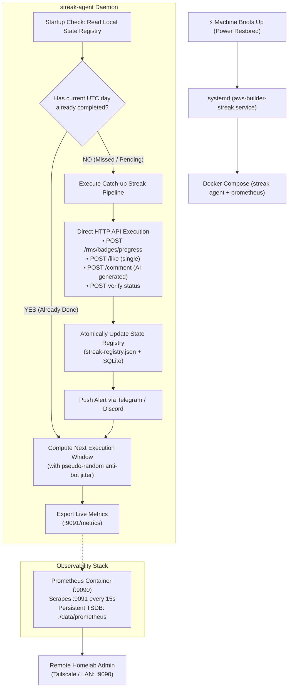

# Case Study: Surviving Homelab Power Outages ⚡
## Building a 90-Day Resilient Streak Daemon for AWS Builder Center with Deterministic UTC State Tracking, Systemd Self-Healing, and Prometheus Observability

---

## 1. Executive Summary

Maintaining the 90-consecutive-day badge milestones on **AWS Builder Center** (`builder.aws.com`) requires three distinct actions every single day:
1. 🌐 **Daily Visit**
2. 👍 **Daily Like on Community Content**
3. 💬 **Daily Contextual Comment on Community Content**

A single missed calendar day resets the entire streak counter back to zero. In an enterprise cloud environment with 99.99% SLA virtual machines, scheduling a daily task is trivial. However, running this workload on a **physical homelab server in the Dominican Republic** introduces a real-world infrastructure constraint: **unpredictable electrical grid outages and sudden hardware shutdowns**.

This case study documents the engineering decisions and architecture implemented to transform a fragile browser script into a **self-healing, idempotent, and observable 24/7 daemon** that survives abrupt power loss, automatically catches up on boot, and provides real-time telemetry via Prometheus.

---

## 2. The Core Problem & Failure Modes

### The Homelab Reality
- **Grid Instability**: Power cuts can occur at any time of day, ranging from momentary brownouts to multi-hour blackouts.
- **Lost In-Memory State**: Standard cron jobs or node timers (`setInterval`, node-cron) lose state entirely upon abrupt shutdown. If the server is powered off during the scheduled execution window, the day's run is missed.
- **Risk of Duplicate Actions & Account Flags**: Naive retry scripts run the risk of spamming likes or comments multiple times after a reboot, violating anti-bot policies.
- **Silent Failures & Zero Visibility**: Without active metrics, an administrator has no remote insight into whether today's cycle succeeded or if the daemon died during boot.

```
┌─────────────────────────────────────────────────────────────────────────────────────────┐
│                               THE POWER OUTAGE LIFECYCLE                                │
│                                                                                         │
│  [Normal State] ──► [⚡ Sudden Blackout] ──► [Server Powers Off] ──► [Power Restored]   │
│                                                                            │            │
│                                                                            ▼            │
│  [Streak Saved! 🎯] ◄── [Catch-up or Skip] ◄── [State Registry Checked] ◄── [System Boot]│
└─────────────────────────────────────────────────────────────────────────────────────────┘
```

---

## 3. Engineering Architecture & Core Business Rules

To guarantee 100% streak reliability under intermittent power, the system was re-architected around four foundational pillars:



### Pillar 1: Deterministic UTC 24h State Registry
AWS Builder Center calculates day boundaries in **Universal Coordinated Time (UTC)**. 
- Local date formats or machine-local time zones create edge cases during daylight saving or local midnight transitions.
- The daemon anchors all business rules strictly to `YYYY-MM-DD` in UTC:
  ```typescript
  export function getCurrentUtcDateKey(date: Date = new Date()): string {
    return date.toISOString().slice(0, 10);
  }
  ```
- All interaction runs are persisted to disk in **`streak-registry.json`** and SQLite with atomic writes:
  ```json
  {
    "currentUtcDate": "2026-10-13",
    "currentCycle": {
      "status": "completed",
      "runId": "56c3ce8c-a81b-4741-acc2-6960a14cf159",
      "completedAt": "2026-10-13T15:00:49.273Z",
      "actions": {
        "visit": { "completed": true, "timestamp": "2026-10-13T15:00:05.101Z" },
        "like": { "completed": true, "timestamp": "2026-10-13T15:00:49.273Z" },
        "comment": { "completed": true, "timestamp": "2026-10-13T15:00:49.273Z" },
        "verify": { "completed": true, "timestamp": "2026-10-13T15:00:49.273Z" }
      },
      "streaks": { "visit": 15, "like": 7, "comment": 7, "target": 90 }
    }
  }
  ```

### Pillar 2: Startup Reconciliation & Strict Idempotency
Whenever the container boots:
1. **Reconciliation Check**: It queries `isTodayUtcCompleted()`.
2. **If Already Completed**: It logs a skip message, leaves streak counts intact, and schedules the next run with pseudo-random jitter (e.g. 15-45 minutes).
3. **If Incomplete / Missed**: It immediately triggers execution. If the shutdown occurred mid-run, it inspects action-level flags so it does **not** duplicate an already executed like or comment.
4. **Force Override**: Manual runs allow `--force` for testing, but normal daemon mode is strictly idempotent.

### Pillar 3: Fast HTTP API Engine (Replacing Fragile DOM Scraping)
Initial versions relied on full browser DOM automation via Playwright:
- DOM rendering required loading massive JavaScript bundles, heavy Chromium memory usage, and unpredictable SPA selector timeouts.
- **The Solution**: Replaced DOM actions with a dedicated, reverse-engineered HTTP API client (`ApiClient`):
  - Extracts AWS Builder ID session tokens and cookies from the authenticated browser profile.
  - Interacts directly with `https://api.builder.aws.com` and `https://builder.aws.com`.
  - Discovers community articles via feed endpoints, likes posts via single REST calls, and posts AI-generated peer comments using contextual article metadata.
  - **Result**: Daily execution time dropped from **3–5 minutes** to **under 5 seconds**, drastically reducing the window of vulnerability to power cuts during execution.

### Pillar 4: Kernel-Level Self-Healing via Systemd
To ensure the service starts without user intervention when power returns:
- Managed under `systemd --user` with linger enabled (`loginctl enable-linger yvniel`):
  ```ini
  [Unit]
  Description=AWS Builder Center Streak Agent 24/7 Daemon
  After=docker.service network-online.target
  Wants=network-online.target

  [Service]
  Type=simple
  WorkingDirectory=/home/yvniel/aws-builder-task-agent
  ExecStartPre=-/usr/bin/docker compose stop streak-agent prometheus
  ExecStart=/usr/bin/docker compose up streak-agent prometheus
  ExecStop=/usr/bin/docker compose stop streak-agent prometheus
  Restart=always
  RestartSec=10
  TimeoutStopSec=30
  StandardOutput=journal

  [Install]
  WantedBy=default.target
  ```
- **Lifecycle Guarantee**: When AC power is restored, the homelab UEFI boots Ubuntu, systemd brings up networking and Docker, and automatically launches both the streak agent and Prometheus.

---

## 4. Full-Stack Observability with Prometheus

To make the infrastructure observable remotely without SSH access, a native Prometheus metrics exporter was built directly into the agent.

### Lightweight Zero-Dependency Metrics Exporter
Implemented in TypeScript using native `node:http`:
- **Port**: `9091` (`GET /metrics`, `GET /health`)
- **Resource Footprint**: < 1MB RAM, 0 extra npm packages.

### Exported Prometheus Metrics

| Metric Name | Type | Description | Sample Value |
|---|---|---|---|
| `aws_streak_up` | Gauge | Daemon operational status (1 = running) | `1` |
| `aws_streak_days{type="..."}` | Gauge | Current consecutive days completed | `visit: 15, like: 7, comment: 7` |
| `aws_streak_target_days` | Gauge | Milestone target | `90` |
| `aws_streak_days_remaining` | Gauge | Days left to reach 90-day milestone | `83` |
| `aws_streak_today_completed` | Gauge | 1 if current UTC day is finished, 0 if pending | `1` |
| `aws_streak_action_completed{action="..."}` | Gauge | Individual action status for current cycle | `visit: 1, like: 1, comment: 1` |
| `aws_streak_last_action_timestamp_seconds` | Gauge | Epoch timestamp of last completed action | `1791903648` |
| `aws_streak_next_execution_timestamp_seconds`| Gauge | Scheduled epoch for next daily execution | `1791991355` |
| `aws_streak_seconds_until_next_run` | Gauge | Countdown in seconds until next run | `73054` (~20.2h) |
| `aws_streak_consecutive_failures` | Gauge | Consecutive failure counter in current cycle | `0` |
| `aws_streak_process_uptime_seconds` | Gauge | Continuous process uptime | `1245` |

### Prometheus Container Stack
Prometheus runs in Docker Compose (`prom/prometheus:latest`) on port `9090`:
- **Scrape Interval**: 15s
- **Storage**: Persistent TSDB on host mount `./data/prometheus` (survives shutdowns with WAL replay).
- **Remote Access**: Reachable via Tailscale mesh VPN (`http://100.83.70.119:9090`) or LAN (`http://10.0.0.18:9090`).

---

## 5. Verification & Failure Simulation

### Scenario A: Clean Same-Day Execution
```text
[SCHEDULER] Daily streak scheduler started in America/New_York.
[SCHEDULER] ℹ️ Startup check: Today's UTC run already completed for 2026-10-13 (Run ID: 56c3ce8c-...).
[SCHEDULER] Next daily streak execution scheduled for 2026-10-14T15:22:35.580Z (in 20.36h, includes 37.6m jitter)
[METRICS] 📊 Prometheus metrics server listening on http://0.0.0.0:9091/metrics
```

### Scenario B: Simulated Abrupt Shutdown During Wait Window
1. Power cut simulated via `sudo systemctl reboot` during the 20-hour wait window.
2. Machine boots up without human interaction.
3. Systemd brings up `aws-builder-streak.service`.
4. Agent inspects `streak-registry.json`: confirms today's run is already completed.
5. Prometheus recovers TSDB from disk WAL in **484µs** and resumes scraping target `streak-agent:9091` with zero data loss.

### Scenario C: Simulated Power Cut Covering the Entire Run Window
1. Machine remains unpowered during the scheduled 10:45 window and powers back on at 16:00 UTC.
2. Startup reconciliation discovers `isTodayUtcCompleted() === false`.
3. Agent immediately fires catch-up execution, likes an unliked article, posts an AI-generated comment, verifies badge progress, and pushes a Telegram alert:
   > 🟢 *AWS Builder Streak Completed (Catch-up on Boot)*
4. Registry marks today completed; next run is scheduled for the subsequent UTC cycle.

---

## 6. Key Lessons for Production & Remote Engineering

1. **Never rely on in-memory timers for mission-critical business logic.**
   Always decouple scheduling from state. The source of truth must reside in durable storage, evaluated dynamically on boot.
2. **Idempotency is the ultimate defense against network and power anomalies.**
   Designing operations so they can be retried 10 times without side effects eliminates 95% of distributed systems bugs.
3. **Observability must be built-in, not bolted-on.**
   Exporting lightweight metrics via standard Prometheus text exposition enabled instant Grafana/PromQL monitoring and remote health checking across a Tailscale private network with zero vendor lock-in.
4. **Linux primitives (`systemd`, `cgroups`, `journald`) remain the gold standard for edge resilience.**
   Orchestration tools (Kubernetes, Ansible) have their place, but for single-node survivability, systemd's PID 1 kernel integration provides bulletproof recovery.
